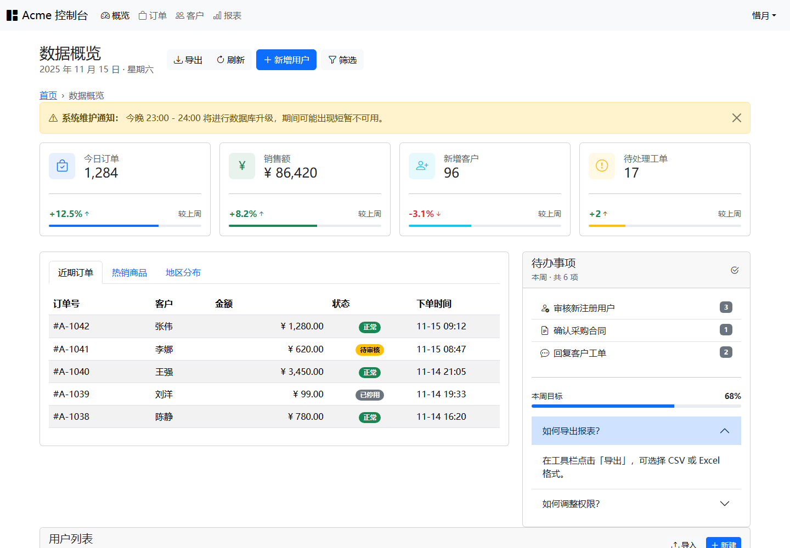
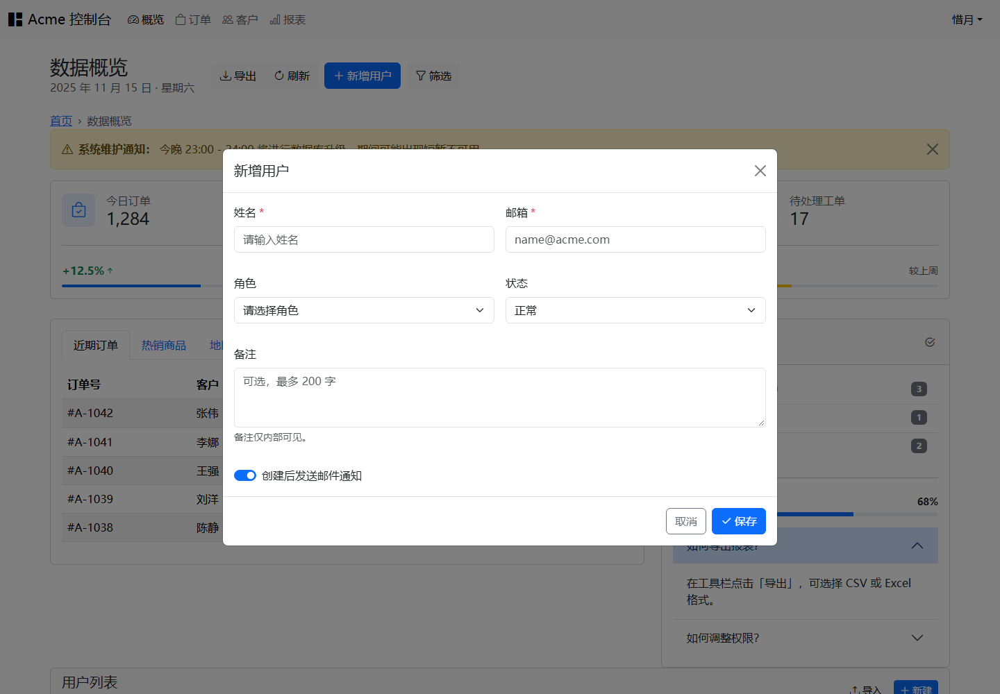

# bootstrap-python

[](https://pypi.org/project/bootstrap-python/)
[](https://pypi.org/project/bootstrap-python/)
[](LICENSE)
<!-- 建好仓库后换成真实地址：
[](https://github.com/<owner>/<repo>/actions/workflows/ci.yml)
-->

用 **Pydantic 模型**描述 [Bootstrap 5](https://getbootstrap.com/) 界面，并直接渲染成 HTML。

每个组件都是类型安全的 pydantic 模型：字段写错会立刻抛 `ValidationError`，文本默认转义，
组合与复用靠 Python 的列表和嵌套完成。交互（弹窗、抽屉、标签页、折叠面板、提示气泡）全部由
Bootstrap 的 `data-bs-*` 属性驱动，**不需要 Vue/React，也不需要前端构建**，
适合服务端渲染、后台页面、报表和邮件页面。

```python
from bootstrap_ui import Page, Card, Table

page = Page(title="用户", body=[
    Card(title="用户列表", body=[
        Table(columns=["ID", "姓名"], rows=[[1, "张三"], [2, "李四"]]),
    ]),
])
print(page.render())      # 完整 HTML 文档
```

## 特性

- **类型安全**：组件字段由 pydantic 校验（`extra="forbid"`），拼错参数名直接报错，不会静默失效；
- **默认转义**：文本自动逃逸，需要可信 HTML 时显式 `raw()`；
- **零前端依赖**：产物是纯 HTML + Bootstrap CDN，不需要 Node、打包器或前端框架；
- **可组合**：组件就是 Python 对象，函数、列表推导、循环都能直接用来生成页面；
- **三种输出**：`render()` 出 HTML，`to_dict()` / `to_json()` 出结构化描述；
- **可定制外壳**：`Page(theme=..., cdn=..., css=..., custom_css=..., custom_js=...)`，或用
  `Page.render(template_name=...)` 换成自己的 jinja2 模板。

## 安装

```bash
pip install bootstrap-python
```

要求 Python ≥ 3.9、pydantic ≥ 2.5、jinja2 ≥ 3.1。

> 发行名是 `bootstrap-python`，导入名是 `bootstrap_ui`：安装后写 `from bootstrap_ui import Page`。

## 快速上手

```python
from bootstrap_ui import Page, Card, Row, Col, Table, Badge, Color

page = Page(
    title="运营看板",
    body=[
        Row(gutter=3, children=[
            Col(md=6, body=[Card(title="今日订单", body=["1,284"])]),
            Col(md=6, body=[Card(title="状态", body=[
                Badge(text="正常", color=Color.success, pill=True),
            ])]),
        ]),
        Table(
            columns=["订单号", "客户", "金额"],
            rows=[["#A-1042", "张伟", "¥ 1,280.00"]],
            striped=True,
        ),
    ],
)

page.save("dashboard.html")
```

生成结果：

```html
<!DOCTYPE html>
<html lang="zh-CN">
<head>
  ...
  <link rel="stylesheet" href="https://cdn.jsdelivr.net/npm/bootstrap@5.3.3/dist/css/bootstrap.min.css">
</head>
<body>
<div class="container py-4">
<div class="row g-3">
<div class="col-md-6"><div class="card h-100">...
```

## 演示

[`examples/dashboard.py`](examples/dashboard.py) 用组件拼出一个完整的后台概览页，
生成结果 [`examples/dashboard.html`](examples/dashboard.html)：

```bash
python examples/dashboard.py
```



弹窗与抽屉同样由组件描述，点击按钮即可打开：



## 组件清单

| 分类 | 组件 |
|---|---|
| 页面/布局 | `Page` `Container` `Row` `Col` `Stack` `Box` `Fragment` `Hr` |
| 文本/内容 | `Heading` `Paragraph` `Span` `Strong` `Small` `Link` `Image` `Icon` |
| 卡片/列表 | `Card` `ListGroup` `ListItem` `Badge` `Alert` |
| 按钮 | `Button` `ButtonGroup` `CloseButton` |
| 导航 | `Navbar` `Nav` `NavItem` `Dropdown` `DropdownItem` `Breadcrumb` `Pagination` |
| 数据展示 | `Table` `TableColumn` `Progress` `Spinner` `Tabs` `TabItem` `Accordion` `AccordionItem` `Carousel` |
| 浮层 | `Modal` `Offcanvas` `Toast` `ToastContainer` `Tooltip` |
| 表单 | `Form` `FormGroup` `field()` `Label` `Input` `Textarea` `Select` `Checkbox` `RadioGroup` `InputGroup` `Fieldset` `Hidden` |
| 常量 | `Color` `Size` `Alignment` `Justify` `Placement` `Breakpoint` |
| 内核 | `Node` `RawHtml` `raw()` `render_attrs()` `render_children()` |

## 常用写法

```python
from bootstrap_ui import (
    Button, Checkbox, Color, Form, Icon, Input, Modal, Offcanvas, Select,
    Span, Table, TableColumn, field, raw,
)

# 表单：控件 + 标签 + 帮助文本
Form(action="/users", method="post", submit_label="保存", body=[
    field("姓名", Input(name="name", required=True), required=True),
    field("邮箱", Input(name="email", type="email"), help="用于接收通知"),
    field("角色", Select(name="role", placeholder="请选择",
                         options=[("管理员", "admin"), ("普通用户", "user")])),
    Checkbox(name="notify", label="保存后发送邮件", switch=True),
])

# 表格：字典行 + 组件单元格
Table(
    columns=[TableColumn(label="状态", key="status", align="center")],
    rows=[{"status": Badge(text="正常", color=Color.success)}],
)

# 弹窗：按钮和模态框用 id 关联
Button(text="新增", toggle_modal="user-modal")
Modal(id="user-modal", title="新增用户", body=[...], footer=[Button(text="取消", outline=True)])

# 抽屉
Button(text="筛选", toggle_offcanvas="filter-panel")
Offcanvas(id="filter-panel", title="筛选", placement="end", body=[...])

# 不产生包裹标签的组合，或插入可信 HTML
Span(body=[Icon(name="star-fill"), " 收藏"])
raw("<div class='ratio ratio-16x9'>…</div>")
```

## 输出与字段约定

```python
node.render()    # HTML 字符串（唯一真正用于交付的）
node.to_dict()   # 结构化描述：字段名、Bootstrap 类、子节点，可 JSON 序列化
node.to_json()   # 上面结果的 JSON 文本
```

`to_dict()` 保留子类的全部字段（pydantic 的 `serialize_as_any`），并自动去掉空的 `attrs`/`style`：

```python
>>> Card(title="卡片", body=[Badge(text="x")]).to_dict()
{'body': [{'text': 'x', 'color': 'primary', 'pill': False}],
 'title': '卡片', 'actions': [], 'image_position': 'top'}
```

字段约定：

- `class_name` → HTML 的 `class`（序列化为 `"class"`），用于追加任意 Bootstrap 工具类；
- `style` 支持字符串或字典（`{"min-width": "10rem"}`，键里的 `_` 会转成 `-`）；
- `attrs` 放任意原生属性，例如 `attrs={"data-bs-toggle": "tooltip", "aria-label": "提示"}`；
- 文本默认转义；只有 `RawHtml` / `raw()` 会原样输出。

## 设计取舍

| | 手写 HTML / 模板字符串 | 本库的组件模型 |
|---|---|---|
| 转义 | 容易漏，XSS 靠自觉 | 文本默认转义，可信片段需显式 `raw()` |
| 结构 | 拼接字符串，缩进和闭合靠人肉 | 列表嵌套，标签自动闭合 |
| 字段校验 | 写错属性名浏览器静默忽略 | pydantic `extra="forbid"`，构造时直接报错 |
| 复用 | 复制粘贴片段 | 函数/类/列表推导，组合自由 |
| 改样式 | 全局搜替换 | 改一处 `class_name` 或组件默认值 |

同时要明确它**不是**什么：这不是前端框架，没有响应式状态、没有数据绑定、不做前端请求。
分页、筛选、行内编辑这类交互需要后端配合刷新页面，或自己补少量 JS；
如果页面需要复杂的前端交互，请直接用 React/Vue 或配套的前端方案，不要硬套本库。

## 项目结构

```
bootstrap_ui/          # 源码包
  types.py             # Node 基类：属性渲染、转义、to_dict/to_json
  constants.py         # Color / Size / Alignment ...
  layout.py            # Page / Container / Row / Col / Stack / Box / Fragment / Hr
  content.py           # Heading / Span / Card / Alert / ListGroup / Button ...
  nav.py               # Navbar / Nav / Dropdown / Pagination / Breadcrumb
  data.py              # Table / Tabs / Accordion / Progress / Carousel / Spinner
  overlays.py          # Modal / Offcanvas / Toast / Tooltip
  forms.py             # Form / FormGroup / Input / Select / Checkbox / RadioGroup ...
  templates/
    page.jinja2        # HTML 外壳（CDN、主题、自动初始化 Toast 与 Tooltip）
examples/
  dashboard.py         # 示例脚本：生成 dashboard.html
  dashboard.html       # 生成结果（可直接用浏览器打开）
tests/
  test_render.py       # 24 个单元测试（含 HTML 标签闭合检查）
docs/images/           # 截图
```

## 开发

```bash
git clone https://github.com/<owner>/<repo>.git
cd bootstrap-python

python -m venv .venv
source .venv/bin/activate        # Windows: .venv\Scripts\activate
pip install -e ".[dev]"

python -m unittest discover -s tests -v    # 24 项测试
python examples/dashboard.py               # 重新生成示例页面
```

提交前建议跑一遍：

```bash
python -m build && python -m twine check dist/*
```

## 发布

仓库内置 [`.github/workflows/publish.yml`](.github/workflows/publish.yml)，
打 tag 后自动构建并通过 **Trusted Publishing（OIDC）** 发布到 PyPI，无需在仓库里保存 token。

```bash
# 1. 更新 pyproject.toml 的 version 和 CHANGELOG.md
# 2. 提交并打 tag
git tag v0.1.1
git push origin main --tags
```

首次使用前，需要去 PyPI 的 *Publishing* 页面添加一个 **pending publisher**：
owner/repository 填本仓库，workflow 填 `publish.yml`，environment 填 `pypi`。

## 已知限制

1. **交互能力有限**：分页、筛选、行内编辑都是静态 HTML，需要后端配合或自己写少量 JS；
2. **不校验类名**：`class_name` 里写错 Bootstrap 类不会报错（Bootstrap 本身也不校验）；
3. **CDN 依赖**：默认从 jsdelivr 加载 Bootstrap，离线场景请把资源下载到本地并改 `Page(cdn=...)` / `Page(css=...)`；
4. **PyPI 页面不显示相对路径图片**：README 里的截图使用仓库相对路径，在 GitHub 正常、在 PyPI 上不显示。

## 变更记录

见 [CHANGELOG.md](CHANGELOG.md)。

## License

[MIT](LICENSE)
